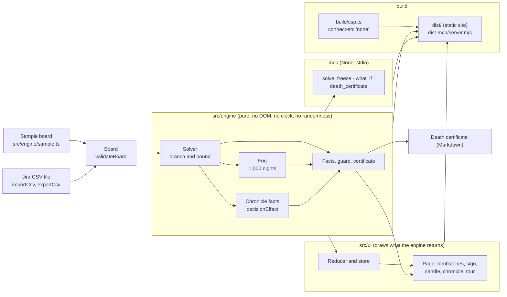

# Architecture

Deadline Séance helps a team decide, the night before a release freeze, which tickets to cut. This page is the short technical overview. The longer sources are the three steering files and the eight specs in `.kiro/specs/`, and `docs/rule.md` (the design log, in Spanish).

Everything below describes what the code does today.

## Modules and data flow

Dependencies point one way: `ui` → `engine`, `mcp` → `engine`, `tests` → `engine`. The engine imports nothing from the other folders, and a test (`tests/engine/purity.test.ts`) scans its sources for the DOM, the clock and `Math.random`. The page and the MCP server call the same functions, so no rule is written twice.

Where the data goes:

1. A board comes from the built-in sample (`src/engine/sample.ts`, Monday 2026-11-16 09:00 to Friday 18:00, `Europe/Madrid`) or from an imported Jira CSV (`src/engine/csv.ts`). Both go through `validateBoard`, which rejects a dependency cycle, an unknown key or a bad row and says which one.
2. `solveFreeze` computes the capacity between `now` and `freezeAt`, applies the reserve, and returns the kept and buried tickets with a reason for each buried one.
3. The fog simulates the kept set over 1,000 nights and returns the chance that it fits.
4. The chronicle records each decision with its effect on the saved cost of delay and supports undo.
5. `facts.ts` gathers every number the text may say. `certificate.ts` writes the Markdown note, and `guard.ts` checks that every number, date, time and ticket key in it is one of the facts.
6. The UI (`src/ui`) keeps one state and one reducer, calls the engine through `src/engine/index.ts`, and renders the result. The MCP tools call the same engine and return the same facts.

## The rule

Pick the tickets to keep so that:

1. The effort fits the capacity after the reserve (`floor(capacity × (100 − reserve) / 100)`).
2. Every must-have is kept.
3. A kept ticket keeps its whole dependency chain. Nothing that depends on a put-down ticket is kept.
4. The saved cost of delay is as large as possible.

This is a 0/1 knapsack over dependency closures. The solver (`src/engine/solver.ts`) is a branch and bound with an integer fractional-knapsack bound. Cost of delay is `value + urgency + risk`, each on the scale 1, 2, 3, 5, 8, 13, 20, or an imported `cod` used as is. Ties are broken in a fixed order: bury fewer tickets, then less effort, then the alphabetically smaller list of buried keys. The first three levels fold into one integer weight per ticket (`weights.ts`), and the last is decided at the leaves. The same board in any ticket order gives the same tombstones.

Capacity is counted in half days (morning 09:00 to 13:00, afternoon 14:00 to 18:00, Monday to Friday, in the board time zone). A half day counts when its midpoint (11:00 or 16:00) falls in `now ≤ midpoint < freezeAt`. Every quantity is an integer.

Two outcomes are stated by the rule itself, without any generated text:

- Impossible freeze: the must-haves and their dependencies exceed the capacity. The message gives the numbers.
- Exhume: a tombstone becomes a must-have and the rule solves again. If that makes the freeze impossible, it is refused and says by how much.

A buried ticket that has been left out at `threshold` consecutive releases (default 3) is a zombie. Its urgency climbs one step on the scale for every release it was left out. A zombie can be resurrected (same as exhume) or put down (Won't Do, removed from the board).

## The fog of estimates

The fog (`src/engine/fog.ts`, `hash.ts`) answers: if the estimates are wrong, how often does the kept work still fit?

- Each night, each ticket's effort becomes `ceil(effort × f / 100)`, where `f = 80 + MurmurHash3(seed, key, night) mod 71`. That is a factor from 80 % to 150 %.
- The hash is MurmurHash3 x86 32-bit over the seed, the ticket key and the night number, using `Math.imul` and shifts only. No random number generator holds state.
- There are 1,000 nights. A night holds when the total of the kept tickets is at most the capacity. The chance shown is `floor(100 × nights that hold / 1,000)`, and the screen also gives the count.
- Because the factor depends only on the seed, the key and the night, two kept sets see the same numbers (common random numbers). Keeping a subset of a set never holds on fewer nights.
- The sample board's seed is 20261116, and every imported board uses it too.

The sign shows the chance for each reserve from 0 to 30 % in steps of 5. On some boards a bigger reserve lowers the chance, so the app shows the numbers and never says that more reserve is safer.

## Key decisions

| Decision | Why |
|---|---|
| No network. `build/csp.ts` sets `default-src 'none'` and `connect-src 'none'`, and fonts are bundled. `tests/ui/csp.test.ts` checks the policy. | A judge can try the app with no setup, and a CSV with company data never leaves the browser. |
| No LLM in this build. Epitaphs, change explanations and the certificate are fixed templates over engine facts. | The app works the same with no key and no network. Adding a model would need a CSP change as well as client code. |
| Deterministic numbers only. Every number comes from `src/engine`, and the UI never computes a decision, capacity, cost or probability. | The same board always gives the same cut, and a property test can check it. |
| Text reaches the page with `textContent` only. `tests/ui/imports.test.ts` scans `src/ui` and fails on `innerHTML` and similar. | Ticket titles come from a user's file, so they must never be read as markup. `tests/ui/xss.test.ts` tries hostile titles. |
| A number guard on generated text (`guard.ts`). | Every number, date, time and key in a note must be one of the facts it was given, or the text is rejected. The guard proves where a number came from, not that it is right, so two real certificates are kept as golden files in `docs/examples/`. |
| A 60 kB budget, gzipped, for the script and the stylesheet together. `tests/ui/build.test.ts` fails above it. | The app must run on a low-end PC. The last build measured about 48 kB. |
| Plan B for boards over 30 tickets (`src/ui/fog-cache.ts`). | While the candle or the reserve is being dragged, a larger board keeps the last fog figures, marked as stale, and computes new ones when the drag settles. A curve for 80 tickets took a median of 14 ms in the measurement noted in that file. |
| A cap of 60 open tickets on CSV import (`CSV_LIMITS` in `csv.ts`). The other limits are 1 MiB, 2,000 rows, 300 columns and 100 errors. | 60 is the size at which the cut stays instant. A larger project should be filtered by version or sprint before export. |
| The tour is a client of the app. It presses the app's own controls and writes no chronicle entries. | The video and the page cannot disagree. `docs/video-tour-script.md` is generated from the tour data, and a test fails if it drifts. |

## Testing

The suite is Vitest with fast-check: 83 test files and 1,532 tests. Run it with `npm test`. Every rule property has its own test named with its number, and `tests/engine/traceability.test.ts` fails if a number P1 to P27 has no test in the file the table names, if a test claims a number outside that range, or if any test is skipped or focused.

| Property | What it says | File |
|---|---|---|
| P1 fits | Kept effort never exceeds the capacity. | `solver.test.ts` |
| P2 must-haves | No must-have is buried. | `solver.test.ts` |
| P3 dependencies | A kept ticket has all its dependencies kept. | `solver.test.ts` |
| P4 partition | Kept and buried do not overlap and make up the whole board. | `solver.test.ts` |
| P5 optimal | Same saved cost and same kept set as brute force. | `solver.test.ts` |
| P6 more capacity | Saved cost does not drop when capacity grows. | `solver.test.ts` |
| P7 determinism | Any ticket order gives the same tombstones. | `solver.test.ts` |
| P8 nothing left over | No buried ticket worth something fits in the gap. | `solver.test.ts` |
| P9 impossible iff | Impossible exactly when must-haves plus dependencies exceed capacity. | `impossible.test.ts` |
| P10 exhume | The exhumed ticket is kept and the saved cost never rises. | `exhume.test.ts` |
| P11 capacity never grows | A later `now`, an earlier freeze, fewer people or more absences never add capacity. | `capacity.test.ts` |
| P12 epitaph guard | Every epitaph shown passes the guard against its ticket's facts. | `ui/epitaph-guard.test.ts` |
| P13 CSV round trip | Export then import gives the same tickets. | `csv.test.ts` |
| P14 slots | Capacity of an interval is the sum of its two parts at any split. | `capacity.test.ts` |
| P15 diff | Cost raised minus cost sunk equals the change in saved cost. | `diff.test.ts` |
| P16 formula | Raising value, urgency or risk never buries a kept ticket. | `cod.test.ts` |
| P17 zombie | A zombie is exactly a buried ticket past the threshold. | `zombie.test.ts` |
| P18 put down | Putting down a zombie changes neither saved cost nor the kept set. | `zombie.test.ts` |
| P19 fog determinism | Same board, seed and kept set give the same result in any order. | `fog.test.ts` |
| P20 fog monotone | A subset of a kept set never holds on fewer nights. | `fog.test.ts` |
| P21 fog extremes | All 1,000 nights hold when even the worst fit, none when even the best do not. | `fog.test.ts` |
| P22 margin | Kept effort never exceeds the capacity with the reserve. | `solver.test.ts` |
| P23 hunger | Urgency never falls with releases left out, never below its start, never above 20. | `cod.test.ts` |
| P24 certificate | Every number in the certificate is in the computed facts. | `certificate.test.ts` |
| P25 undo | Undo gives back exactly the previous state, solution, diff, fog and certificate. | `ui/chronicle.test.ts` |
| P26 CSV hostile input | The round trip holds with hostile titles, comma files and semicolon files. | `csv.test.ts` |
| P27 cascade | If a ticket is buried, everything that depends on it is buried. | `solver.test.ts` |

Other checks beyond the properties:

- **Brute-force oracle.** `src/engine/oracle.ts` tries every subset (at most 16 tickets) and must agree with the solver on saved cost. The properties use boards of 12 or fewer.
- **Independent references.** `tests/engine/reference.ts` rewrites the dependency chain logic apart from `chain.ts`. `tests/engine/fog-reference.ts` rewrites the fog from the spec alone, with a `BigInt` hash that shares no code with `hash.ts`. The engine must agree with both exactly.
- **Published vectors.** The MurmurHash3 implementation is checked against published test vectors.
- **Mutation checks.** The specs call for them to be run by hand: break one rule on a copy of the file, name the test that fails, revert, then do the next. They run one at a time and are not part of `npm test`. The death certificate spec lists eight for the guard and the certificate.
- **Goldens.** Two death certificates, the CSV export, and the tour script (`docs/video-tour-script.md`) are compared with generated output.
- **Whole-app tests.** Accessibility, contrast, hostile input (`xss.test.ts`), the CSP and the build size run against the real bundle.
- **The PostFileSave hook.** `.kiro/hooks/test-on-engine-save.json` runs `npm test` whenever a file under `src/engine` or `tests/engine` is saved, so a rule change is checked as it is written.

## Which spec built what

Each feature started as a Kiro spec (`requirements.md`, `design.md`, `tasks.md`) under `.kiro/specs/<folder>/`.

| Spec | Folder | What it produced |
|---|---|---|
| Rule engine | `rule-engine` | `src/engine`: `types`, `keys`, `chain`, `validate`, `weights`, `capacity`, `cod`, `solver`, `oracle`, `diff`, `index`; the generators and the property tests. |
| Board UI | `board-ui` | `src/ui` and `src/main.ts`: store, reducer, `derive`, `text`, `dom`, the renderers (sign, candle, survivors, grounds, chains), sound, atmosphere, styles; `build/csp.ts` and the Pages workflow. |
| Fog | `fog` | `src/engine/fog.ts`, `src/engine/hash.ts`, `src/ui/fog-cache.ts`, `src/ui/render/fog.ts`. |
| Night tour | `night-tour` | `src/ui/tour/*` (player, script, simulation, restore, script document) and `src/ui/render/tour.ts`. |
| Death certificate | `death-certificate` | `src/engine/facts.ts`, `guard.ts`, `certificate.ts`, `src/ui/night.ts`, `src/ui/render/certificate.ts`. |
| Jira CSV | `jira-csv` | `src/engine/csv.ts`, `src/ui/release.ts`, `src/ui/render/banner.ts`, `src/ui/render/csv-group.ts`. |
| MCP server | `mcp-server` | `mcp/*`, plus `src/engine/messages.ts` and `src/engine/sample.ts`, which the page and the server share. |
| Night chronicle | `night-chronicle` | `src/engine/chronicle.ts`, `src/ui/chronicle.ts`, `src/ui/keys.ts`, `src/ui/render/chronicle.ts`. |

The table lists the modules each spec added. Later specs also changed earlier files (for example, the certificate spec added a section for the chronicle).

## The MCP server

`mcp/` is a small Node program that serves the rule over stdio with the official MCP SDK (`@modelcontextprotocol/server`, pinned at 2.4.0) and zod schemas. It offers three read-only tools: `solve_freeze` (the cut list with a reason for every buried ticket), `what_if` (one change: exhume, put down, someone away or back, move the freeze, change the reserve) and `death_certificate` (the stakeholder note). It imports `src/engine` and nothing else of the app, makes no network call, reads no file and no clock, and every time is an input. `node mcp/start.mjs` builds `dist-mcp/server.mjs` when a source is newer, then serves it. This repository's `.kiro/settings/mcp.json` registers it for Kiro. Details and one call per tool are in [mcp.md](mcp.md).

## The Kiro Crew companion

[deadline-seance-crew](https://github.com/hvaler/deadline-seance-crew) is a separate repository that reuses this engine unchanged and reads live Jira through a read-only local board, then hands the data to an agent in Kiro Crew. It carries a copy of the engine bundle and does not import this repository, which in turn does not depend on it and works alone and offline.
